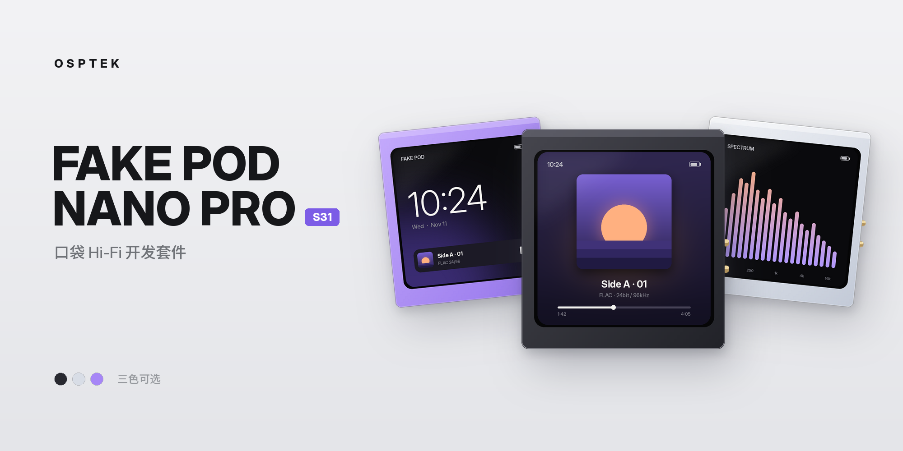

# FAKE POD NANO PRO

OSPTEK 口袋 Hi-Fi 开发套件 · ESP32-S31 主控 · CS43131 解码耳放 · 460 × 460 AMOLED

  

  
  
  
  
  

  <b>简体中文</b> &nbsp;|&nbsp; <a href="README_EN.md">English</a>

## 简介

FAKE POD NANO PRO 是 OSPTEK 推出的口袋 Hi-Fi 开发套件，本仓库对应 ESP32-S31 版本（FAKE POD NANO PRO S31）。

整机以 ESP32-S31 为主控，搭载 Cirrus Logic CS43131 解码耳放芯片和一块 460 × 460 圆角 AMOLED 触摸屏。它可以从 TF 卡播放 MP3 / FLAC 本地音乐，有线输出按音源采样率直通、不重采样；也可以作为 USB 声卡、USB 读卡器，或作为蓝牙音频接收端 / 发送端使用。机身为 CNC 阳极氧化铝外壳。

### 典型用途

- 便携本地音乐播放器
- USB 解码耳放
- 蓝牙音频接收器 / 发射器
- 视频、图片、电子书等多媒体小终端
- 基于 ESP32-S31 的音频与图形界面二次开发

## 硬件规格

| 项目 | 参数 |
| :--- | :--- |
| 主控 | ESP32-S31（支持经典蓝牙音频、PPA 硬件图形加速） |
| 显示屏 | 460 × 460 AMOLED，CO5300 驱动，QSPI 接口 |
| 触摸 | CST820 电容触摸 |
| 音频 | Cirrus Logic CS43131 DAC + 耳放，硬件音量控制，24.576 MHz 晶振；本板最高 96 kHz |
| 存储 | TF 卡（4-bit SDMMC） |
| 麦克风 | PDM 麦克风 |
| 惯性传感器 | QMI8658 六轴 IMU（加速度计 + 陀螺仪） |
| 电源管理 | AXP2101 |
| RTC 时钟 | PCF85063 |
| USB | 正反插：默认方向为 USB 串口（日志、烧录），翻面后为 USB 声卡（UAC）/ USB 存储（MSC） |
| 按键 | 上方电源键（AXP2101）、下方按键（GPIO） |
| 外壳 | CNC 阳极氧化铝 |

完整原理图见 [hardware/FakePod_S31_Schematic_V1.0.pdf](hardware/FakePod_S31_Schematic_V1.0.pdf)。

> [!NOTE]
> CS43131 芯片手册中的 130 dB 动态范围、-115 dB THD+N、384 kHz 等为芯片能力，不代表整机实测指标。本板最高采样率为 96 kHz。

## 二次开发

整机基于 ESP-IDF 开发，目标芯片为 `esp32s31`。板载外设的 GPIO 分配、I²C 地址和各接口的参考配置见 [开发者硬件说明（V1 量产版）](docs/hardware_v1.md)。

## 外壳模型

外壳的 STEP 3D 模型位于 [`hardware/enclosure/`](hardware/enclosure)，可用于设计配件或自制外壳：

| 零件 | 材质 | 文件 |
| :--- | :--- | :--- |
| 本体 | 铝合金 CNC | [`FakePod_S31_Body_Aluminum_CNC.step`](hardware/enclosure/FakePod_S31_Body_Aluminum_CNC.step) |
| 右侧盖板 | 铝合金 CNC | [`FakePod_S31_RightCover_Aluminum_CNC.step`](hardware/enclosure/FakePod_S31_RightCover_Aluminum_CNC.step) |
| 左侧盖板 | 黑色不透光亚克力 | [`FakePod_S31_LeftCover_BlackAcrylic.step`](hardware/enclosure/FakePod_S31_LeftCover_BlackAcrylic.step) |

## 出厂固件

### 功能

| 应用 | 功能 |
| :--- | :--- |
| 回放 PLAYBACK | 本地音乐播放（MP3、FLAC），支持歌单与封面 |
| 音源 RP2A03 | NSF 芯片音乐播放 |
| 解析 SPECTRUM | 麦克风动态频谱 |
| 映像 VIDEO | MJPEG 动画、指定格式 AVI 视频 |
| 画像 IMAGE | JPG 图片浏览 |
| 文書 TEXT | UTF-8 文本阅读 |
| 中枢 CORE | 设置 |

主菜单为蜂窝式布局。从屏幕底部向上滑动可呼出菜单；在音乐播放器中需先回到播放控制页再上滑。

### 工作模式

在设置页右下角进入 **BOOTMODE**，选择模式并确认后设备重启进入对应模式。回到日常使用时，再次进入模式菜单选择 NORMAL。

| 模式 | 说明 |
| :--- | :--- |
| 汎用模式 NORMAL | 日常本地播放、看图、阅读；可向蓝牙耳机 / 音箱发送音频 |
| 藍牙受信 BT AUDIO | 接收手机、电脑的蓝牙音频（SBC / AAC，实际编码取决于发送端） |
| 音頻接続 USB AUDIO | USB 声卡，24 bit，48 / 96 kHz，设备名 `N7_UAC_ESP32S31_CS43131` |
| 數據格納 USB DISK | 将 TF 卡作为 U 盘挂载到电脑 |

> [!TIP]
> USB AUDIO 和 USB DISK 需要把 USB 插头**翻面**后插入。电脑上只出现串口时，说明插接方向不对。

### 按键

| 按键 | 功能 |
| :--- | :--- |
| 上方电源键（短按） | 音量 + |
| 下方按键（短按） | 音量 - |
| 下方按键（长按） | 锁屏 / 唤醒 |

惯性手势切歌可在设置中开关。

### TF 卡资源

TF 卡格式化为 FAT32，把仓库 [`tfcard/`](tfcard) 下的各文件夹直接复制到 TF 卡根目录（不要再套一层文件夹）。出于版权原因，资源包中的 `music/`、`playlist/`、`nsf/` 为空目录，请自行放入音乐和 NSF 文件：

| 目录 | 内容 |
| :--- | :--- |
| `music/` | 音乐（MP3、FLAC），按专辑或歌单分为一级子文件夹 |
| `playlist/` | 歌单，由设备生成 |
| `fonts/` | 与固件配套的字体 |
| `mjpeg/` | MJPEG 动画与 AVI 视频（MJPEG 视频 + AAC / MP3 音频，460 × 460，目标 30 fps） |
| `pic/` | JPG 图片，建议 460 × 460、baseline JPG |
| `txt/` | UTF-8 文本 |
| `nsf/` | NSF 芯片音乐 |
| `night7/` | 开机动画、默认封面等运行资源 |

增删歌曲后，在设置的「应用选项」中更新歌单，也可以用电脑上的歌单生成器生成。MP4 直接改扩展名为 `.avi` 无法播放，需要重新编码。

开机动画、默认封面的替换要求见 [`tfcard/night7/替换注意.txt`](tfcard/night7/替换注意.txt)。

### 电脑端工具

[`tools/`](tools) 下是两个 Windows 小工具（需要 .NET Framework）：

| 工具 | 用途 |
| :--- | :--- |
| [`SMART_CONVERTER.exe`](tools/SMART_CONVERTER.exe) | 基于 FFmpeg 把视频转换为设备可播放的 MJPEG / AVI，支持预览和批量转换。需要同目录下有 `ffmpeg.exe` |
| [`歌单生成器.exe`](tools/歌单生成器.exe) | 扫描 TF 卡 `music/` 下的文件夹，在 `playlist/` 中生成 `.npl` 歌单 |

### 蓝牙发送

1. 在 NORMAL 模式下准备好音乐。
2. 在「连接选项」中选择蓝牙启动方式，按提示重启。
3. 让蓝牙耳机 / 音箱进入配对状态（先断开与手机的连接）。
4. 在「蓝牙音频」页搜索并选择目标设备。
5. 连接成功后回到音乐播放器播放。

设备会记住上次连接的目标。蓝牙发送在音源采样率与蓝牙编码采样率不同时会重采样；有线输出不重采样。

### 烧录

可使用 [ESP 在线烧录工具](https://pressf5.run/esp-flash/)（桌面版 Chrome / Edge）或 `esptool.py` 烧录。烧录时 USB 使用默认插接方向（串口）。

> [!IMPORTANT]
> S3、P4、S31 版本的固件和 GPIO 定义不能混用。请使用与硬件对应的 S31 固件和资料。

## 参考资料

- [FAKE POD NANO PRO S31 使用说明](https://pressf5.run/?p=280)
- [固件与资源包下载](https://pressf5.run/?p=38)
- [CS43131 数据手册](https://statics.cirrus.com/pubs/proDatasheet/CS43131_DS1155F2.pdf)

## 许可证

- 代码：[Apache-2.0](LICENSE)
- 硬件资料与文档（`hardware/`、`docs/`）：[CC BY-NC-SA 4.0](LICENSE-CC-BY-NC-SA-4.0)
- 第三方组件沿用其原有许可证

  <b>O S P T E K</b> &nbsp;·&nbsp; <code>FAKE-POD-NANO-PRO</code>

