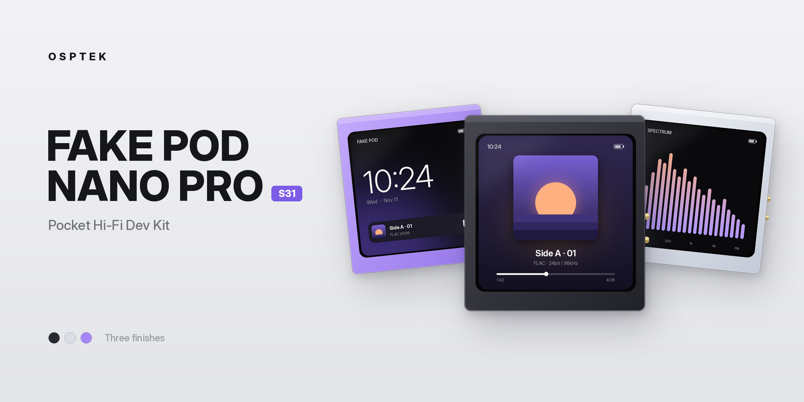

# FAKE POD NANO PRO

OSPTEK Pocket Hi-Fi Development Kit · ESP32-S31 · CS43131 DAC/Amp · 460 × 460 AMOLED

  

  
  
  
  
  

  <a href="README.md">简体中文</a> &nbsp;|&nbsp; <b>English</b>

## Overview

FAKE POD NANO PRO is a pocket Hi-Fi development kit by OSPTEK. This repository covers its ESP32-S31 version (FAKE POD NANO PRO S31).

It is built around the ESP32-S31, with a Cirrus Logic CS43131 DAC/headphone amplifier and a 460 × 460 AMOLED touch display. It plays MP3 / FLAC from a microSD card, with wired output passing the source sample rate through without resampling. It can also act as a USB audio device, a USB card reader, or a Bluetooth audio receiver / transmitter. The enclosure is CNC-machined anodized aluminum.

### Typical Uses

- Portable local music player
- USB DAC / headphone amplifier
- Bluetooth audio receiver / transmitter
- Small multimedia terminal for video, images and e-books
- Audio and GUI development on the ESP32-S31

## Hardware Specifications

| Item | Specification |
| :--- | :--- |
| MCU | ESP32-S31 (Classic Bluetooth audio, PPA graphics acceleration) |
| Display | 460 × 460 AMOLED, CO5300 driver, QSPI |
| Touch | CST820 capacitive touch |
| Audio | Cirrus Logic CS43131 DAC + headphone amp, hardware volume, 24.576 MHz crystal; up to 96 kHz on this board |
| Storage | microSD (4-bit SDMMC) |
| Microphone | PDM microphone |
| IMU | QMI8658 6-axis (accelerometer + gyroscope) |
| Power Management | AXP2101 |
| RTC | PCF85063 |
| USB | Reversible: default orientation is USB serial (logs, flashing); flipped is USB Audio (UAC) / Mass Storage (MSC) |
| Buttons | Top power button (AXP2101), bottom button (GPIO) |
| Enclosure | CNC anodized aluminum |

The full schematic is in [hardware/FakePod_S31_Schematic_V1.0.pdf](hardware/FakePod_S31_Schematic_V1.0.pdf).

> [!NOTE]
> Figures in the CS43131 datasheet (130 dB dynamic range, -115 dB THD+N, 384 kHz, etc.) are chip capabilities, not measured results for this device. This board supports up to 96 kHz.

## Development

Firmware can be developed with ESP-IDF, targeting `esp32s31`. GPIO assignments, I²C addresses and reference configurations for the onboard peripherals are in the [Developer Hardware Guide (V1 production)](docs/hardware_v1_EN.md).

## Enclosure Models

STEP 3D models of the enclosure are in [`hardware/enclosure/`](hardware/enclosure), for designing accessories or making your own enclosure:

| Part | Material | File |
| :--- | :--- | :--- |
| Body | CNC aluminum | [`FakePod_S31_Body_Aluminum_CNC.step`](hardware/enclosure/FakePod_S31_Body_Aluminum_CNC.step) |
| Right cover | CNC aluminum | [`FakePod_S31_RightCover_Aluminum_CNC.step`](hardware/enclosure/FakePod_S31_RightCover_Aluminum_CNC.step) |
| Left cover | Opaque black acrylic | [`FakePod_S31_LeftCover_BlackAcrylic.step`](hardware/enclosure/FakePod_S31_LeftCover_BlackAcrylic.step) |

## Factory Firmware

### Features

| App | Function |
| :--- | :--- |
| PLAYBACK | Local music player (MP3, FLAC) with playlists and covers |
| RP2A03 | NSF chiptune player |
| SPECTRUM | Live spectrum from the microphone |
| VIDEO | MJPEG animations and AVI video in the supported format |
| IMAGE | JPG image viewer |
| TEXT | UTF-8 text reader |
| CORE | Settings |

The main menu uses a honeycomb layout. Swipe up from the bottom of the screen to open the menu; in the music player, return to the playback control page first.

### Modes

Open **BOOTMODE** at the bottom right of the settings page, pick a mode and confirm; the device reboots into that mode. To return to everyday use, open the mode menu again and choose NORMAL.

| Mode | Description |
| :--- | :--- |
| NORMAL | Local playback, images, reading; can send audio to Bluetooth headphones / speakers |
| BT AUDIO | Receive Bluetooth audio from a phone or PC (SBC / AAC, depending on the sender) |
| USB AUDIO | USB audio device, 24-bit, 48 / 96 kHz, device name `N7_UAC_ESP32S31_CS43131` |
| USB DISK | Expose the microSD card to a computer as a USB drive |

> [!TIP]
> USB AUDIO and USB DISK require the USB plug to be **flipped**. If the computer only sees a serial port, the plug is in the wrong orientation.

### Buttons

| Button | Function |
| :--- | :--- |
| Top power button (short press) | Volume up |
| Bottom button (short press) | Volume down |
| Bottom button (long press) | Lock / wake screen |

Gesture track skipping (IMU) can be turned on or off in settings.

### microSD Resources

Format the card as FAT32 and copy the folders under [`tfcard/`](tfcard) directly to the card root (not inside another folder). For copyright reasons, `music/`, `playlist/` and `nsf/` are left empty; add your own music and NSF files:

| Folder | Contents |
| :--- | :--- |
| `music/` | Music (MP3, FLAC), one level of subfolders by album or playlist |
| `playlist/` | Playlists, generated by the device |
| `fonts/` | Fonts matching the firmware |
| `mjpeg/` | MJPEG animations and AVI video (MJPEG video + AAC / MP3 audio, 460 × 460, 30 fps target) |
| `pic/` | JPG images, 460 × 460 baseline JPG recommended |
| `txt/` | UTF-8 text |
| `nsf/` | NSF chiptunes |
| `night7/` | Boot animation, default cover and other runtime resources |

After adding or removing songs, update the playlist under App Options in settings, or generate it on a PC with the playlist maker. An MP4 renamed to `.avi` will not play; it must be re-encoded.

Requirements for replacing the boot animation and default cover are in [`tfcard/night7/替换注意.txt`](tfcard/night7/替换注意.txt) (Chinese).

### PC Tools

[`tools/`](tools) contains two small Windows utilities (require .NET Framework):

| Tool | Purpose |
| :--- | :--- |
| [`SMART_CONVERTER.exe`](tools/SMART_CONVERTER.exe) | FFmpeg-based converter that turns videos into MJPEG / AVI the device can play, with preview and batch mode. Needs `ffmpeg.exe` in the same folder |
| [`歌单生成器.exe`](tools/歌单生成器.exe) (Playlist Maker) | Scans the folders under `music/` on the card and writes `.npl` playlists to `playlist/` |

### Bluetooth Transmit

1. Prepare music in NORMAL mode.
2. Choose the Bluetooth start mode under Connection Options and reboot if prompted.
3. Put the headphones / speaker into pairing mode (disconnect them from your phone first).
4. Search for and select the target on the Bluetooth Audio page.
5. Once connected, return to the music player and play.

The device remembers the last target. Bluetooth transmit resamples when the track's sample rate differs from the Bluetooth codec rate; wired output does not resample.

### Flashing

Use the [ESP web flasher](https://pressf5.run/esp-flash/) (desktop Chrome / Edge) or `esptool.py`. Keep the USB plug in the default (serial) orientation when flashing.

> [!IMPORTANT]
> Firmware and GPIO definitions for the S3, P4 and S31 versions are not interchangeable. Use the S31 firmware and documentation that match your hardware.

## References

- [FAKE POD NANO PRO S31 user guide (Chinese)](https://pressf5.run/?p=280)
- [Firmware and resource pack downloads (Chinese)](https://pressf5.run/?p=38)
- [CS43131 datasheet](https://statics.cirrus.com/pubs/proDatasheet/CS43131_DS1155F2.pdf)

## License

- Code: [Apache-2.0](LICENSE)
- Hardware files and documentation (`hardware/`, `docs/`): [CC BY-NC-SA 4.0](LICENSE-CC-BY-NC-SA-4.0)
- Third-party components retain their original licenses

  <b>O S P T E K</b> &nbsp;·&nbsp; <code>FAKE-POD-NANO-PRO</code>

